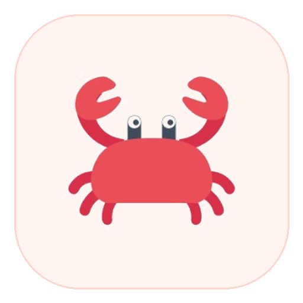
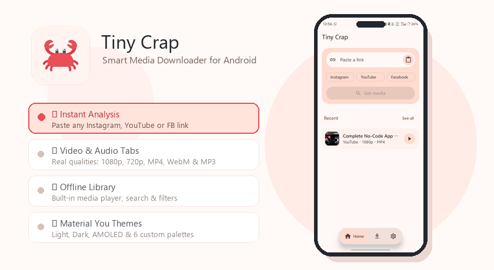
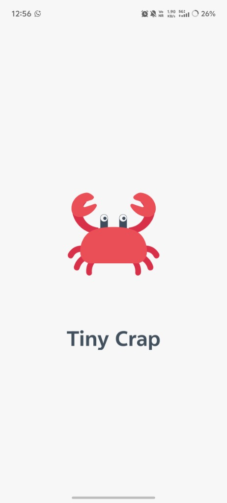
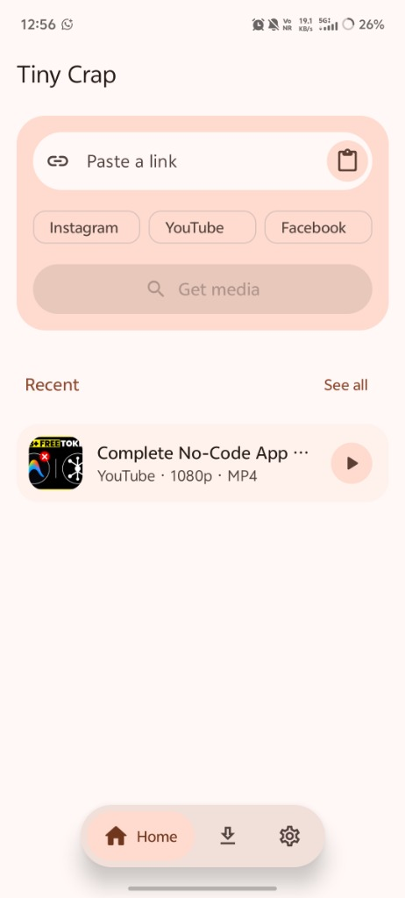
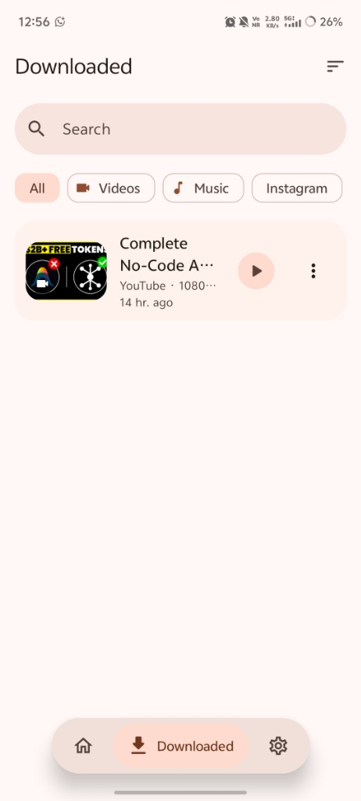
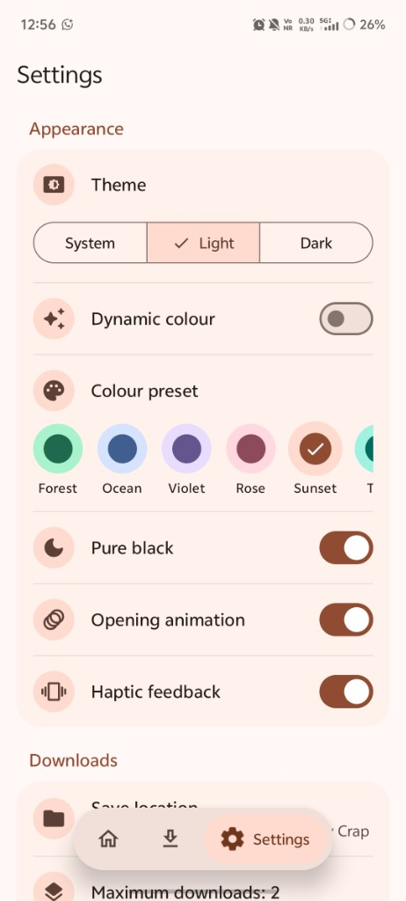
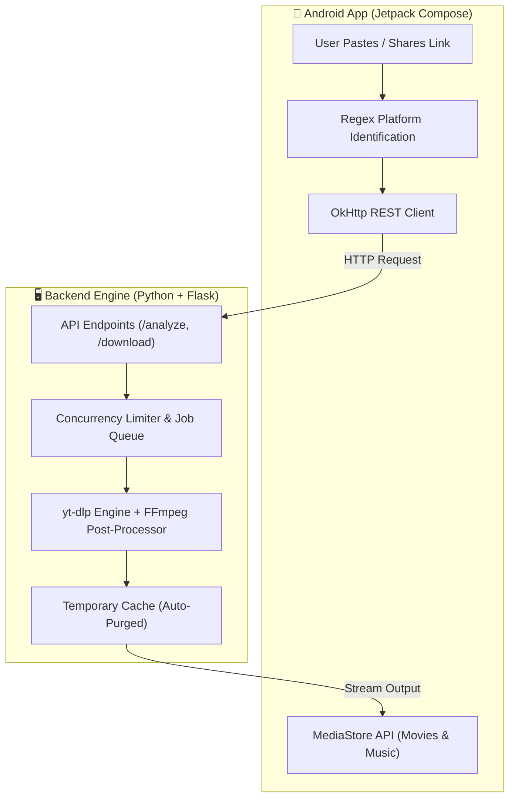

<p align="center">
  <a href="https://github.com/YouBTech01/TinyCrap">
    
  </a>
</p>

<h1 align="center">Tiny Crap</h1>

<p align="center">
  <b>The Ultimate Open-Source Social Media Video & Audio Downloader for Android</b><br>
  Download high-definition videos, reels, shorts, and lossless audio from <b>Instagram</b>, <b>YouTube</b>, and <b>Facebook</b>.
</p>

<p align="center">
  <a href="https://github.com/YouBTech01/TinyCrap/releases/latest">
    
  </a>
  <a href="https://github.com/YouBTech01/TinyCrap/stargazers">
    
  </a>
  <a href="https://github.com/YouBTech01/TinyCrap/blob/main/LICENSE">
    
  </a>
</p>

<p align="center">
  
  
  
  
  
  
</p>

---

## 🎬 Live Motion Graphic Demo

<p align="center">
  
</p>

---

## 🌐 Supported Platforms & Downloadable Content

Tiny Crap provides unified, one-tap downloading across major social networks. It queries the raw stream sources using `yt-dlp` and `FFmpeg` to deliver exact resolutions with zero compression degradation.

| Platform | Official Logo | Downloadable Content | Available Formats & Quality |
| :--- | :---: | :--- | :--- |
| **Instagram** |  | <ul><li>Reels & Short Clips</li><li>Video Posts & Carousels</li><li>IGTV Videos</li><li>Original Audio Streams</li></ul> | **Video:** 1080p FHD, 720p HD (MP4)<br>**Audio:** Lossless stream / MP3 |
| **YouTube** |  | <ul><li>YouTube Shorts</li><li>Full HD Long-form Videos</li><li>Podcasts & Music Tracks</li><li>60 FPS High Framerate Videos</li></ul> | **Video:** 1080p, 720p, 480p, 360p (MP4, WebM)<br>**Audio:** Best Stream, MP3 (up to 320kbps), M4A, Opus, WAV, FLAC |
| **Facebook** |  | <ul><li>Facebook Reels</li><li>Facebook Watch Videos</li><li>Public Page Uploads</li><li>Group & Timeline Videos</li></ul> | **Video:** HD 1080p / SD (MP4)<br>**Audio:** Extracted MP3 / M4A |

---

## 📱 App Interface & Screenshots

<div align="center">

| 🦀 Splash Mascot | ⚡ Smart Downloader | 📂 Downloads Vault | 🎨 Themes & Customization |
| :---: | :---: | :---: | :---: |
|  |  |  |  |
| *Fluid crab opening animation* | *Auto-detection & format picker* | *Built-in player, search & filters* | *Material You, 6 presets & AMOLED* |

</div>

---

## ⚡ Key Features

### 🎯 1. Universal "Share to Download" Workflow
- **Auto-Platform Recognition**: Paste any link or tap **Share → Tiny Crap** inside Instagram, YouTube, or Facebook.
- **Deep Analysis**: Extracts actual platform thumbnails, author details, stream bitrates, video durations, and real available codecs.

### 🎥 2. Genuine Video & Lossless Audio Formats
- **Accurate Video Selection**: Only real source qualities are shown (1080p, 720p, 480p) in MP4 or WebM with file size estimations.
- **Audiophile Audio Extraction**: Extract original stream audio with **Zero Re-encoding** (`Best Audio`), or convert to MP3, M4A, Opus, WAV, or FLAC with custom bitrates.

### 🎨 3. Next-Gen Material 3 (Material You) Design
- **Dynamic Theming**: Adapts to your phone's Android 12+ wallpaper colors automatically.
- **Curated Color Presets**: Switch instantly between **Forest, Ocean, Violet, Rose, Sunset, and Tangerine**.
- **Pure Black AMOLED**: Saves battery on OLED displays with true `#000000` pitch-black backgrounds.

### 📂 4. Built-in Media Library
- **Scoped Storage Integration**: Downloads directly to `Movies/Tiny Crap` and `Music/Tiny Crap` using Android's `MediaStore` (no runtime storage permission required).
- **Search & Filter Tabs**: Categorize your library by **All, Videos, Music, or Instagram**, and play media instantly in-app.

### 🛡️ 5. 100% Private, Secure & Stateless
- **No Logins or Accounts**: Zero registration required.
- **No Database Tracking**: No history or personal telemetry stored anywhere.
- **Auto-Purge Server**: Temporary download cache on the backend is deleted automatically after delivery.

---

## 🏗️ System Architecture

Tiny Crap is split into two cleanly decoupled components:
1. **Frontend App**: Native Android application written in **Kotlin** with **Jetpack Compose**.
2. **Backend Engine**: Lightweight **Python Flask** server with worker queuing, **yt-dlp**, and **FFmpeg**.



---

## 🚀 Quick Setup & Installation

### Option A: Install Android APK (Recommended)
1. Head over to [**Releases**](https://github.com/YouBTech01/TinyCrap/releases/latest).
2. Download **`TinyCrap-v2.1.0.apk`**.
3. Install on your Android 10+ smartphone.

---

### Option B: Self-Host the Backend Server

```bash
# 1. Clone repository
git clone https://github.com/YouBTech01/TinyCrap.git
cd TinyCrap/backend

# 2. Set up virtual environment
python -m venv .venv
source .venv/bin/activate       # Windows: .venv\Scripts\activate

# 3. Install requirements
pip install -r requirements.txt

# 4. Start the server (requires FFmpeg on PATH)
python server.py --host 0.0.0.0 --port 8000
```

Verify backend health at: `http://127.0.0.1:8000/api/health`

---

### Option C: Build the Android App from Source

1. Open the [`frontend/`](frontend/) folder in **Android Studio** (API 35, JDK 17).
2. Sync project with Gradle files.
3. Configure your server URL in the app settings:
   - **Android Emulator**: `http://10.0.2.2:8000`
   - **Physical Device**: `http://<your-pc-ip>:8000` (e.g. `http://192.168.1.50:8000`)
4. Build release APK:
   ```bash
   cd frontend
   ./gradlew assembleRelease
   ```

---

## ⚙️ Backend Environment Variables

Configuration settings can be added to `backend/.env`:

| Key | Default | Description |
| :--- | :---: | :--- |
| `TINYCRAP_TEMP_DIR` | System Temp | Directory for intermediate media processing |
| `TINYCRAP_CLEANUP_MINUTES` | `30` | Minutes before server automatically purges downloaded files |
| `TINYCRAP_MAX_CONCURRENT_JOBS` | `2` | Maximum concurrent downloads active server-wide |
| `TINYCRAP_MAX_FILESIZE_MB` | `500` | Maximum single media size limit in megabytes |
| `TINYCRAP_API_KEY` | *None* | Optional secret required in the `X-API-Key` header |
| `TINYCRAP_TRUST_PROXY` | `0` | Set to `1` when hosting behind reverse proxies (Nginx / Cloudflare) |

---

## 🔍 Search & SEO Metadata

`Tiny Crap` is engineered to fulfill key open-source utility searches:
- **Instagram Reels Downloader APK**: Download HD Reels, Instagram video carousels, and stories.
- **YouTube Video & Shorts Downloader**: Download 1080p 60fps MP4 and extract crystal-clear 320kbps MP3 audio.
- **Facebook Watch Downloader**: Fast public Facebook video and reel saver for mobile.
- **Jetpack Compose Android Video Downloader**: Clean architecture reference implementation using Material 3 and modern Android best practices.

---

## ⚖️ Disclaimer

This open-source project is strictly intended for **educational, archiving, and personal backup purposes**. Please adhere to each platform's Terms of Service and copyright laws. Only download public content that you have explicit permission to access and save.

---

<p align="center">
  <b>Developed & Maintained by <a href="https://github.com/YouBTech01">YouBTech01</a></b><br>
  ⭐️ Star this repo if you find it helpful!
</p>
