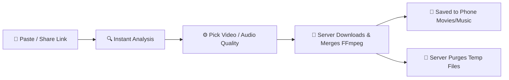

<p align="center">
  <a href="https://github.com/YouBTech01/TinyCrap">
    
  </a>
</p>

<h1 align="center">Tiny Crap</h1>

<p align="center">
  <b>A lightweight, high-performance social media video & audio downloader for Android.</b><br>
  Built with native <b>Jetpack Compose (Material 3)</b> and powered by a private <b>Python Flask + yt-dlp</b> backend.
</p>

<p align="center">
  
  
  
  
  
</p>

---

## 🎬 Motion Preview

<p align="center">
  
</p>

---

## 📱 App Screenshots

<div align="center">

| 🦀 Splash Welcome | ⚡ Smart Downloader | 📂 Downloads Library | 🎨 Custom Themes |
| :---: | :---: | :---: | :---: |
|  |  |  |  |
| *Smooth crab opening animation* | *Auto platform detection & quality selector* | *Built-in player, search & filters* | *Material You, custom palettes & AMOLED* |

</div>

---

## ✨ Features

- 🔗 **Universal Link Processing**: Copy or share links directly from **Instagram, YouTube, and Facebook**. Tiny Crap automatically identifies the platform and queries available streams.
- 🎯 **Accurate Quality Selection**:
  - **Video**: Download in real resolutions (1080p, 720p, 480p) in MP4 or WebM containers with accurate size estimates.
  - **Audio**: Single-tap extraction for **Best Audio** (lossless stream copy), or convert to MP3, M4A, Opus, WAV, and FLAC at customizable bitrates.
- 🎨 **Adaptive Material 3 Design**:
  - Full **Material You (Dynamic Color)** support on Android 12+.
  - Curated aesthetic presets: **Forest, Ocean, Violet, Rose, Sunset, and Tangerine**.
  - True **Pure Black (AMOLED)** dark mode and configurable haptic feedback.
- 📁 **Organized Local Library**:
  - Seamless Android `MediaStore` integration — saved directly to `Movies/Tiny Crap` and `Music/Tiny Crap` without invasive storage permissions.
  - In-app playback, instant search, and smart filtering (Videos, Music, Instagram).
- 🔒 **Privacy-Focused & Stateless**:
  - No database, no tracking, no user accounts.
  - Temporary files on the server are purged automatically after job completion.

---

## 🏗️ Project Architecture

```
TinyCrap/
├── assets/                     # App logo, motion graphics GIF & screenshots
├── backend/                    # Python Flask server (yt-dlp + FFmpeg)
│   ├── tinycrap/               # API routes, queue manager, diagnostics
│   ├── server.py               # Application entry point
│   └── passenger_wsgi.py       # cPanel / Passenger deployment entry
└── frontend/                   # Native Android application
    └── app/src/main/           # Jetpack Compose UI, MediaStore saver, OkHttp client
```

### Flow Diagram



---

## 🚀 Quick Start Guide

### 1. Run the Backend Server

The backend requires **Python 3.9+** and **FFmpeg** installed and accessible on your PATH.

```bash
cd backend

# Create and activate virtual environment
python -m venv .venv
source .venv/bin/activate       # On Windows: .venv\Scripts\activate

# Install dependencies
pip install -r requirements.txt

# Start backend server
python server.py --host 0.0.0.0 --port 8000
```

> **Testing Health**: Open `http://127.0.0.1:8000/api/health` to confirm that `yt-dlp` and `FFmpeg` are detected.

---

### 2. Build & Run the Android App

1. Open the [`frontend/`](frontend/) directory in **Android Studio** (Koala or newer).
2. Allow Gradle to sync dependencies.
3. Connect your Android device or start an emulator:
   - **Emulator**: Default server address is `http://10.0.2.2:8000`.
   - **Physical Device**: Go to **Settings → Server** in the app and set your computer's local Wi-Fi IP (e.g., `http://192.168.1.15:8000`).
4. Press **Run (Shift + F10)**.

To compile a release APK from command line:
```bash
cd frontend
./gradlew assembleRelease
```

---

## ⚙️ Backend Configuration

Optional environment variables (can be placed in `backend/.env`):

| Variable | Default | Description |
|---|---|---|
| `TINYCRAP_TEMP_DIR` | System Temp | Directory for intermediate media processing |
| `TINYCRAP_CLEANUP_MINUTES` | `30` | Auto-deletion timer for completed downloads |
| `TINYCRAP_MAX_CONCURRENT_JOBS` | `2` | Maximum concurrent downloads server-wide |
| `TINYCRAP_MAX_FILESIZE_MB` | `500` | Maximum allowable download size in MB |
| `TINYCRAP_API_KEY` | *None* | Optional secret required in the `X-API-Key` header |
| `TINYCRAP_TRUST_PROXY` | `0` | Set to `1` when hosted behind a reverse proxy (Nginx / Cloudflare) |

---

## ⚠️ Disclaimer

This tool is created for **personal backup, archiving, and educational purposes**. Please respect the content creators' intellectual property and platform Terms of Service. Only download public media that you have the right to access and store.

---

<p align="center">
  Crafted with ❤️ by <a href="https://github.com/YouBTech01"><b>YouBTech01</b></a>
</p>
